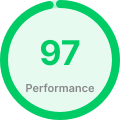
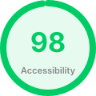

# Клуб четырех коней ♟️🏆

> **«Дело помощи утопающим — дело рук самих утопающих! Шахматы двигают вперед не только культуру, но и экономику!»**  
> — *О. Бендер, Гроссмейстер*

Интерактивный адаптивный лендинг Международного васюкинского турнира по шахматам, вдохновленный главой XXXIV романа Ильи Ильфа и Евгения Петрова «Двенадцать стульев». Проект создан как демонстрационная работа (пет-проджект) для комплексной оценки навыков современной семантической верстки, работы с препроцессорами и построения адаптивных UI-сетк.

https://okudakaeva.github.io/chess_tourneer/

   

---

## 🛠️ Технологический стек и особенности реализации

При разработке интерфейса были применены современные стандарты фронтенд-верстки и лучшие практики Pixel Perfect:

*   **Модульный Sass/SCSS (Архитектура @use)**: Код полностью избавлен от устаревших инклудов `@import`. Стили разбиты на независимые изолированные модули (`layout`, `buttons`, `marquee`, экраны) и объединены через систему пространств имен `@use`.
*   **Архитектура дизайн-токенов (CSS Custom Properties)**: Все базовые параметры интерфейса (неоновые акценты, сетка, адаптивные шрифты, цвета таблиц и брейкпоинты) вынесены в централизованные переменные `:root`, что позволяет налету менять тему оформления.
*   **Продвинутая адаптивность (Mobile First / Desktop First комбинации)**: Интерфейс безупречно перестраивается на любых экранах — от широкоформатных мониторов до мобильных устройств с экранами 320px. Сложные таблицы параметров мероприятия и двухколоночные гриды гибко трансформируются в линейные мобильные блоки без потери читаемости.
*   **Бесконечная бегущая строка (CSS Marquee Animation)**: Эффектный текстовый баннер реализован на чистом CSS с использованием `will-change: transform`, что гарантирует плавную анимацию с частотой 60 FPS и нулевой нагрузкой на главный поток браузера. При наведении ховера анимация изящно встает на паузу (`animation-play-state: paused`).
*   **Кроссбраузерная оптимизация графики (@supports)**: Для тяжелых фоновых коллажей в шапке используется современный формат `.webp` с автоматическим фолбеком на стандартный `.png` для старых браузеров. Смешивание текстур реализовано через нативный CSS-режим `background-blend-mode: color-burn`.
*   **Доступность и гигиена кода**: Сброс стилей реализован на базе индустриального стандарта `normalize.css`. Разметка полностью валидна, семантична и учитывает системные настройки доступности пользователя (`@media(prefers-reduced-motion: reduce)` для отключения плавного скролла).

---

## 🚀 Инструкция для локального запуска

Проект полностью автономен. Для проверки достаточно склонировать репозиторий и открыть `index.html` в любом браузере:

1.  **Клонируйте репозиторий** и перейдите в папку:
    ```bash
    cd chess_tourneer
    ```

2.  **Установите зависимости** (требуется Node.js для подтягивания модулей):
    ```bash
    npm install
    ```

3.  **Скомпилируйте Sass-стили** (команда сожмет и оптимизирует CSS):
    ```bash
    npm run build
    ```
*Подсказка: если вы планируете изменять стили, запустите режим отслеживания изменений:*
```bash
npx sass --watch styles.scss:styles.css
```
---
*Да здравствует современный веб-стандарт!*
